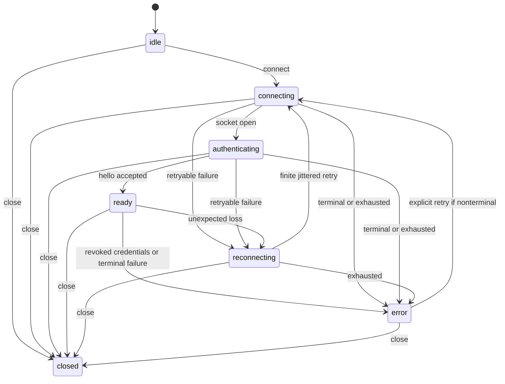

# @integr8-media/ws-rpc

Reusable typed WebSocket RPC transport using oRPC. Applications provide routers, authentication
and context. Server/tooling target Node 24; root/client imports must remain browser-safe.

## Implementation status

Current M5/M6 source is on `feature/m5-offline-delivery`, branched from local `dev` at `dd2b5a3`:

- `/client`: `createRpcClient` with lazy authenticated connect, typed calls, safe snapshots,
  finite reconnect, heartbeat and opt-in managed resubscription with gap notifications.
- `/server`: `createRpcServer` with reserved hello/ping, required authentication context,
  namespace collision detection, deadlines, capacity, expiry and external session revocation.
- `/fastify`: `registerRpcWebSocket` with explicit origin policy, parser limits, duplicate-path
  detection and disposal that closes owned peers while preserving the host and unrelated routes.
- Stream item/byte accounting before ClientPeer queues events, cancellation lifetimes,
  adjacent regression tests, compile fixtures and a loopback smoke playground.
- Explicit M5 queue/receipt-ledger helpers and optional M6 React/Query hooks are written below.

Earlier [verification results](docs/verification-2026-11-12.md) include 131 local tests and
build/size/docs/smoke/stress evidence. Those results predate M5/M6 and do not verify this checkout.
M5/M6 lint and the full source typecheck now pass on local Node 22.22.3 after explicit developer
authorization. Tests, builds, packed/browser/device and target-runtime acceptance remain open.
Private version 0.1.0 is selected; no publication or completed release gate is claimed. Approved
dependencies and an updated lockfile were present before this follow-up; the agent did not install.

See [SPEC and progress](docs/SPEC.md), [dependency approvals](docs/dependency-proposal.md),
[compatibility](docs/transport-compatibility.md), [errors](docs/errors.md) and
[M1 plan](docs/superpowers/plans/2026-11-11-m1-authenticated-calls.md).

## Using the API

Supply `RouterClient<typeof router>` from oRPC as the client factory's type argument. The factory
returns the typed application client alongside connect/close/getSnapshot/subscribe/subscribeStream.
Calls reject before ready; calls are never queued or replayed. Losing a dispatched response yields
OUTCOME_UNKNOWN. Cancellation is cooperative and cannot undo a committed mutation.

Authentication returns `{ context, expiresAt? }`, with expiry in epoch milliseconds. Context must
satisfy the application's required router context. `disconnectSession` invalidates a server-issued
random session ID, never a token. Register the Fastify adapter before listen/ready; its origin
predicate is mandatory, including its decision for absent Origin. Dispose retains a rejecting route
because Fastify cannot unregister it; it does not shut down the host.

See `fixtures/transport/inference.ts` for compile-only input/output/error/stream/context checks and
`playground/smoke.mjs` for an exchange through built public entries with fake loopback credentials.
The root exports RpcError, RpcErrorCode, ConnectionState, ConnectionSnapshot and RpcClientOptions.
Typed application errors retain their upstream data. Never log full errors/causes or credentials.

## Configuration and bounds

Defaults remain those in SPEC. Both pending-stream bounds apply together. The implementation meters
encoded events before upstream buffering, with a separate connection-wide raw decoding backlog cap.
Memory/stress/platform evidence remains required; do not treat source accounting as proven bounds.

Validation ranges: integer timeout/heartbeat/backoff milliseconds 1..2^31-1; backoff base <= maximum;
retryLimit 0..1000; message/socket/pending-stream byte limits 1..64 MiB; in-flight calls 1..10,000;
subscriptions 1..1024; pending items 1..65,536. URLs allow remote wss or loopback ws for development,
and reject user-info, query strings and fragments. Additional local-network ws support needs agreement
on its public configuration. No new runtime-support promise is made by these fixtures.

## Developer-run checks

AGENTS.md reserves installs and implementation commands for the developer. Use Node 24.11+ for the
approved tooling. Run npm install first to resolve the approved M6 pins and regenerate package-lock;
an old lockfile is not sufficient for npm ci. Existing commands are listed below. M5/M6 lint and
the full typecheck pass in the current follow-up; tests/build/consumer evidence remain pending.

```sh
npm run lint
npm run typecheck
npm run test:coverage
npm run build
npm run playground:smoke
npm run check:consumers
npm run test:stress
npm run size
npm run check:exports
npm run docs
```

`format`, `test` and `fixtures` also exist. Typecheck covers production isolated declarations,
a browser project without Node ambient types, tests/config/scripts and compile-only fixtures.
`playground:smoke` builds and starts an ephemeral loopback Fastify/Node-client exchange, checking
context and adapter disposal through built entries, with cleanup in finally.

Build output is separate dist/browser and dist/node ESM .mjs/.d.mts, without source maps. Only dist
is explicitly packaged; npm also includes README automatically. Export checks include publint,
packed type resolution and traversal of the installed browser dependency graph. This conservative
inspection is not a bundled browser/Expo consumer or a device test; those remain M3. Size budgets
measure emitted gzip bytes and exclude external dependency costs.

## Setup and playground

After the developer installs the approved dependencies, `npm run playground:smoke` exercises a
loopback Node client/server through built entries. `npm run playground` builds then starts the real
browser example at http://127.0.0.1:5173. Connect, make a typed lookup, subscribe, unsubscribe and
close. A closed handle is terminal; reload the example to create another. The server accepts only
that exact browser Origin or an explicitly permitted absent Origin for Node, and fake example
credentials. It binds loopback and is not a production authentication or remote-access service.

Minimal browser client (the application owns its router type and credential provider):

```ts
import { createRpcClient } from '@integr8-media/ws-rpc/client';
import type { ExampleClient } from './router.js';

const connection = createRpcClient<ExampleClient>({
  url: 'ws://127.0.0.1:5173/rpc',
  protocolVersions: [1],
  getToken: async () => 'playground-fake-token', // Fixture only.
  createWebSocket: (url) => new WebSocket(url),
});
await connection.connect();
const result = await connection.client.lookup({ id: 'example' });
await connection.close(); // Also call on component/app disposal, not just successful calls.
```

See [example router](playground/router.ts), [server integration](playground/server.mjs) and
[packed Node consumer](fixtures/consumers/node.mts) for complete typed/context/error/stream examples.
Applications normally close in finally and detach state listeners. Register the adapter before
Fastify ready/listen. An externally installed WebSocket plugin must enforce a parser maxPayload
at least as strict as this server's configured message cap. Hosts own TLS and upgrade/rate limits.

## Connection state and delivery



The application client is never an offline queue. Before ready a call rejects DISCONNECTED. After
dispatch, a lost reply can report OUTCOME_UNKNOWN even if the server committed; reconcile with the
application's own contract, never automatically replay. Deadlines and abort request cooperative
cancellation, not rollback. Defined upstream application errors retain code/data; transport failures
use RpcError. Snapshots and diagnostic events contain safe state/codes/session IDs, never tokens.

Use subscribeStream for managed subscriptions. Its open callback receives the typed client and
owned signal; pass that signal to the procedure. Awaiting observer.next applies local consumption
backpressure. If the peer outpaces both pending limits the stream fails BACKPRESSURE. A socket-wide
send high-water violation closes that connection. Ordinary iterators end on loss. Managed
resubscribe:true opts into one fresh stream per authenticated epoch and gap before new items;
there is no implied replay or fabricated resume cursor. Unsubscribe aborts delivery and never reopens.

## Runtime and release evidence

| Consumer | Intended environment | Evidence required |
|---|---|---|
| Server/tooling | Node 24 (24.11+ for approved tools) | Native Node fixtures, coverage/build/export results |
| Browser | Compatible standard WebSocket factory | Real browser playground plus packed bundle graph |
| Node client | Compatible caller-provided socket | Packed native unary/error/stream/disposal exchange |
| Expo Android | Existing app's compatible socket | Physical Android artifact-specific runtime record |
| Expo iPadOS | Existing app's compatible socket | Physical iPadOS artifact-specific runtime record |

These are targets, not a claim that runtime/device acceptance has passed. The Expo probe adds no
React/native dependencies here; it runs in an existing app against reachable wss. Typechecking a
probe cannot establish native compatibility. See [consumer instructions](fixtures/README.md),
[Expo device guide](fixtures/expo/README.md) and [acceptance matrix](docs/acceptance.md).

After version selection and build, `npm run check:consumers` explicitly packs and installs into
isolated temporary consumers outside the repo and retains records in fixtures/.artifacts; it does
not modify the root lockfile or publish.
It checks public declarations, executes Node RPC, and audits all browser chunks with a complete-JS
150 KiB gzip fixture budget including dependency costs. Its source typecheck seams are separate
from these installed-artifact checks. `npm run test:stress` requires dist and measures a finite
native workload with explicit GC, retaining memory samples; its regression envelope is not proof
of exact per-stream/process bounds. All runtime/device results still need actual execution.

PR CI targets dev using the pinned shared config workflow; the supplemental job adds M3 consumers,
stress, docs and retained artifacts. Shared workflow access is repository-owner configuration.
lefthook.yml extends the confirmed config preset, but neither a new Lefthook dependency nor hooks
are installed automatically. Publication/trusted publishing and initial version/license metadata
remain developer decisions. See [unreleased changelog](CHANGELOG.md).

## Migration notes

No earlier published release is claimed. Consumers of an internal/private attempt primitive should
move to the documented public factories and own the returned handle's cleanup. Do not import src,
test helpers or internal built chunks. Select one compatible oRPC release line; these examples use
the approved 1.16.2 APIs, not v2 adapter examples. Keep server router imports type-only in clients.
For pre-publication use, record the exact tarball SHA-256 and lockfile rather than invent an npm
version. The approved M4 extension adds exactly the two /client helpers documented below. M5 offline
delivery is an approved opt-in source extension below. Approved M6 adds only the optional /react
subpath; existing root/client/server/Fastify entries retain their public contracts.

## Named client groups (M4)

```ts
import { createRpcClientGroup } from '@integr8-media/ws-rpc/client';

// catalogConnection and jobsConnection are already-created, independently typed handles.
const group = createRpcClientGroup({ catalog: catalogConnection, jobs: jobsConnection });
const results = await group.connectAll(); // Each name: fulfilled, or rejected with a safe code.
await group.clients.catalog.client.lookup({ id: 'one' });
await group.close('catalog'); // Leaves jobs running; catalog cannot be reopened/replaced.
await group.close(); // Terminal, idempotent; waits for all child cleanup attempts.
```

The group takes lifecycle ownership of 1..32 distinct handles. Its copied registry is readonly;
names are 1..64 characters matching `[A-Za-z][A-Za-z0-9_-]{0,63}`. Invalid names, symbols, aliases,
getter entries or malformed handles fail before listener installation. Keep names nonsecret.
Read aggregate state with getSnapshot and observe future transitions with subscribe; both preserve
the exact registry keys and copied frozen snapshots. Individual child/client types are retained,
including required per-call context. One failed connection does not roll back healthy children.

No automatic routing, failover, shared authentication, extra retry or stream owner. Use group close
for lifecycle ownership; closing a child directly is reflected without affecting siblings. A failed
cleanup still attempts every sibling and reports a safe error. Aggregate snapshot entries reflect
the last observed actual child state, not an invented all-ready/all-closed state on cleanup failure.

## Binary slices and local progress (M4)

```ts
import { chunkBinary } from '@integr8-media/ws-rpc/client';

const source = new Uint8Array([1, 2, 3]);
for await (const chunk of chunkBinary(source, {
  maxBytes: 3,       // Required total input budget; validates before reading.
  chunkBytes: 2,     // Default 65,536; range 1..1,048,576.
  signal,
  onProgress: (event) => showLocalProgress(event),
})) {
  // Application-owned procedure/schema; upstream encoding and transport frame caps still apply.
  await client.binarySize(new Blob([new Uint8Array(chunk).buffer]));
}
```

Sources are Blob or Uint8Array views. maxBytes is a safe integer >=0; oversized known input throws
PAYLOAD_TOO_LARGE synchronously. Chunks are nonempty independent copies, produced on requested pulls.
An empty input produces no chunk. No whole-input copy, file access, transfer ID, acknowledgement,
resume cursor or retry is supplied. Do not mutate an array source during iteration.

Progress is a frozen `{ producedBytes, totalBytes, done }`: initial zero, each locally prepared
chunk, then local EOF when the consumer pulls through completion. It does not prove encoded/sent,
received/persisted bytes or completed transfer. An async callback is awaited; failures propagate
as application callback errors. Abort/early return stops local delivery, observes/discards late
results, and emits no later completion before EOF. EOF is committed before its notification;
abort can release an uncooperative completion observer without undoing that already-observed EOF.

The helper retains caller-owned input and cannot bound chunks retained/requested by the caller.
Raw chunk size is not encoded message size. Existing frame/high-water/stream limits stay active;
Node/browser example checks explicitly characterize this boundary. Source-read failures use safe
INTERNAL, caller cancellation uses CANCELLED. These helpers and native Blob compatibility still
need runtime/packed/device verification; no new runtime support promise is made.

## Explicit offline delivery (M5)

`createRpcOfflineQueue` from `/client` borrows an existing connection and handles one typed command
family. `createRpcDeliveryLedger` from `/server` provides process-local scoped deduplication and
receipts. The [approved contract](docs/superpowers/specs/2026-11-13-m5-offline-delivery-design.md)
defines the full surface; [playground/offlineClient.ts](playground/offlineClient.ts) and
[playground/router.ts](playground/router.ts) show matching application command/status procedures.

```ts
import { createRpcOfflineQueue } from '@integr8-media/ws-rpc/client';

const queue = createRpcOfflineQueue({
  connection, // Already-created typed client; the application still owns connect/close.
  maxEntries: 8,
  maxBytes: 4096,
  maxEntryBytes: 64,
  maxAgeMs: 30_000,
  attemptTimeoutMs: 5000,
  encode: encodeCommand,       // (input: Input) => Uint8Array, synchronous application codec.
  decode: decodeCommand,       // (bytes: Uint8Array) => Input, validates a fresh copy.
  decodeResult,                // (bytes: Uint8Array) => Result, validates server result bytes.
  deliver: sendCommand,        // (typedClient, command, signal, decodedInput) => receipt.
  reconcile: lookupReceipt,    // (typedClient, key, signal) => receipt, read-only.
});
const ticket = queue.enqueue(input, { key: logicalOperationKey, signal });
await connection.connect();
const result = await ticket.result; // Only a validated completed receipt resolves this promise.
await queue.close();                // Releases this queue; leaves connection ownership alone.
```

Keys are non-secret, unique per logical operation, matching `[A-Za-z0-9_-]{1,128}`. maxEntries ranges
from 1 to 10,000; required byte budgets are positive safe integers, maxEntryBytes <= maxBytes;
required durations are integers from 1 to 2,147,483,647 ms. Input/result payloads each fit
maxEntryBytes. Queued, dispatching and uncertain tickets all consume capacity. Admission is
synchronous and copies actual encoded bytes. Snapshots freeze counters, key/state/expiry and safe
codes without payloads. subscribe observes future changes; read getSnapshot for the initial value.

Retained bytes are input bytes + UTF-8 key bytes + 16 metadata bytes per ticket. The ledger includes
UTF-8 scope bytes and reserves maxEntryBytes for result bytes before invoking the handler. JS
objects, codec work, transient copies, encoded transport overhead and caller-held data are outside
that accounting; it is not a total-process memory bound. Existing socket/frame caps still apply.

Unsent commands dispatch FIFO, one callback at a time when ready. Pending/uncertain/missing receipts
never trigger resubmission. After a lost response, the next ready epoch makes at most one read-only
status lookup; queue.reconcile(key) allows another explicit lookup. There is no polling loop. A
callback that ignores its abort signal blocks later callbacks until it settles, while local close
and ticket expiry remain available. Close ignores late callbacks and never waits indefinitely.

Before dispatch, expiry means TIMEOUT and cancellation means CANCELLED. After invocation, expiry
or close means OUTCOME_UNKNOWN; cancellation rejects CANCELLED locally without proving rollback.
The ticket's cancel method is idempotent. Close rejects unsent work CLOSED. A closed borrowed
connection closes the queue too. Terminal auth/protocol failure rejects pending work; do not change
the authenticated principal behind a queue's connection. New identity requires a new queue/handle.

Server setup requires maxEntries/maxBytes/maxEntryBytes, retentionMs/maxCommandAgeMs and
encodeResult/decodeResult. Call ledger.execute(authenticatedScope, command, (payload, signal) =>
runValidatedCommand(payload, signal)) inside an authenticated, authorized application procedure;
ledger.lookup(authenticatedScope, key) belongs in an equally guarded read-only status procedure.
Scope includes stable authenticated identity and operation, is non-secret and at most 256 UTF-8
bytes. Never accept scope from client input or use a session ID as the durable identity.

The helper command is `{ key, expiresAt, payload: Uint8Array }`. Receipt state is pending, uncertain,
completed (with result bytes), or missing (key only, no known expiry). The application owns the wire
schema and validates/maps its byte representation. The examples use bounded number arrays because
oRPC 1.16.2's default JSON serializer does not preserve typed arrays. No raw frame or reserved
transport procedure is introduced.

Ledger execution has its own shutdown signal: disconnecting/cancelling one RPC observer does not
remove the record or cancel that mutation. Identical concurrent submissions join it; conflicting
payload/expiry fails INVALID_MESSAGE. Handler errors propagate unchanged to active callers, while
the ledger retains a safe uncertain tombstone. Codec/oversize-result failures also retain uncertainty.
Wire error mapping remains application-owned; do not serialize raw exceptions.

Pending records stay pinned even after expiry. Settled records stay until
max(expiresAt, settledAt) + retentionMs; retentionMs must cover maxCommandAgeMs. Full ledgers reject
new work rather than evict live records. lookup/admission prune expired settled records without
background timers. Close aborts ledger-owned work but cannot force a handler to roll back.

Queues and ledgers are memory-only. Reload, restart, close, another worker or retention expiry ends
their protection. A receipt means the handler resolved and result bytes were retained locally;
business commit/persistence is the handler's responsibility. No durable or exactly-once guarantee.
M5 source compilation/lint pass; runtime/packed/browser/device verification remains pending.

## Optional React and Query hooks (M6)

Import useRpcSnapshot/useRpcQuery/useRpcMutation only from `@integr8-media/ws-rpc/react`. The
optional peers are React ^19.0.0 and @tanstack/react-query ^5.107.1, plus @types/react ^19.0.0 for
TypeScript. The entire /react entry requires both runtime peers, even for a snapshot-only Node ESM
import. Existing entry points remain usable without those peers; the new no-peer fixture checks
both declaration compilation and runtime import. This boundary is written, not yet pack-verified.

The application creates and owns a stable connection and QueryClient/QueryClientProvider. Hooks
never connect, close, create credentials or choose storage. Keep connections stable across renders;
create new handles when identity changes and use a separate QueryClient per account/request.

```ts
import { useRpcSnapshot, useRpcQuery, useRpcMutation } from '@integr8-media/ws-rpc/react';

// Inside a component/custom hook beneath the application's QueryClientProvider:
const snapshot = useRpcSnapshot(connection);
const read = useRpcQuery({
  connection,
  cacheScope: 'account_server',
  queryKey: ['lookup', id],
  query: (client, signal) => client.lookup({ id }, { signal }),
});
const write = useRpcMutation({
  connection,
  cacheScope: 'account_server',
  mutationKey: ['rename'],
  mutation: (client, input: { id: string; name: string }) => client.rename(input),
});
// User actions explicitly call connection.connect(), read.refetch(), or write.mutate(input).
```

Reads are **manual only**. Render/mount/remount, reconnect, focus, browser-online events and cache
invalidation do not execute them. Query retry/polling/render-prefetch/Suspense are disabled, even
under global Query defaults. Initial/placeholder data is suppressed to avoid showing an old
handle's data. staleTime/gcTime may be finite integer milliseconds 0..2,147,483,647; other Query
policy options are intentionally not accepted. Direct QueryClient fetching/persistence APIs and
application global callbacks remain application-owned and outside these hook guarantees.

Explicit reads/mutations check the current handle immediately before invoking application code:
DISCONNECTED unless ready, CLOSED when explicitly closed. networkMode:always prevents an offline
Query pause from becoming a later unexpected execution. Both helpers fix retry:false. An explicit
refetch/mutate after an unknown outcome is a new application request, not automatic reconciliation.
Use the application's status procedure or M5 queue reconciliation deliberately when needed.

Query callbacks receive the actual per-execution AbortSignal; pass it into the typed oRPC call.
Unmount or Query cancel requests cooperative cancellation, not rollback. Mutations have no
automatic signal: include one in typed variables if needed. Unmount stops UI observation without
closing the connection or cancelling a mutation. Original failures are preserved as unknown in
the hook result because Promise rejection types cannot be inferred; narrow RpcError/ORPCError.

cacheScope is a non-secret ASCII identifier matching [A-Za-z0-9_-]{1,128}; queryKey/mutationKey is
a nonempty readonly QueryKey containing the relevant inputs. Keys must follow Query's serializable
key conventions and must not contain credentials. Effective keys add a weak per-handle identity,
so separate handles do not share cache entries within this loaded integration. Old in-flight work
retains its old key; replacing a handle does not show old query/mutation results. Query data and
mutation variables/results remain in caller-owned Query caches; clear them on logout as needed.

useRpcSnapshot requires no provider and observes the existing cached frozen state through
useSyncExternalStore. SSR/initial hydration return a stable idle snapshot, then switch to live
state. Hooks do not fetch on the server. SSR data hydration/dehydration, persistent caches and
cross-process connection IDs are not supported by this initial integration. Do not share a
server-process QueryClient across users.

Streams continue through the original managed subscription API. In an effect, create the
subscription and return a synchronous cleanup that invokes its async unsubscribe method; keep
open/callback dependencies stable and handle next/error/complete/gap deliberately. The component
owns that subscription, while the connection remains application-owned. No stream-to-cache queue
or additional resubscription owner is introduced.

Run `npm run playground:react` after installation/build to open the fake-token loopback example.
It provides explicit Connect, Read lookup, Send increment and Close actions under StrictMode.
The library exports no UI. This flow, hook tests and packed React/no-peer consumers remain unrun.
React entry JS has a 10 kB gzip budget excluding peers; the separate packed React bundle has a
300 KiB complete-JS budget including peers. Baseline browser 150 KiB and existing total/library
budgets are unchanged. See [M6 acceptance](docs/acceptance.md) before claiming compatibility.
